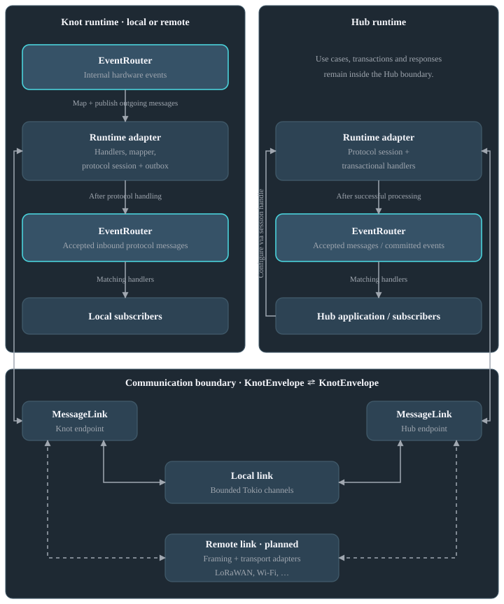
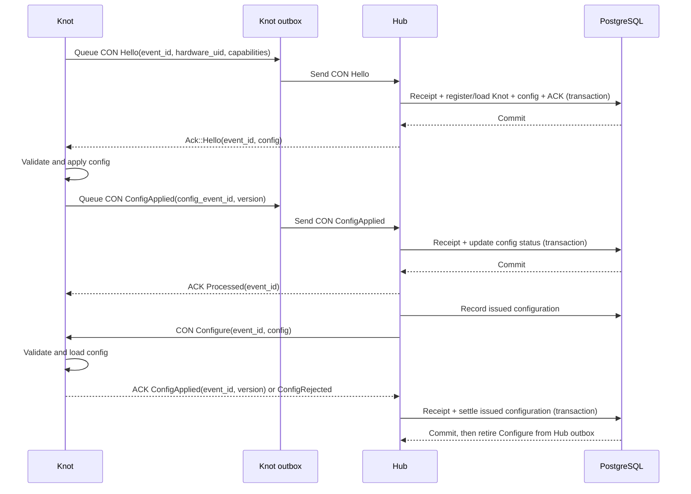

# Event Messaging

ArkSync defines versioned communication contracts between its actors. The currently implemented contract connects a Hub and a Knot, regardless of whether the Knot runs in the Hub process or on remote embedded hardware. These contracts are independent from Tokio, Embassy, MQTT, LoRa, Zenoh, and PostgreSQL.

Confirmable messages use **at-least-once delivery** while their session remains alive; non-confirmable messages are sent once without confirmation. PostgreSQL remains the durable source of truth for station state. ArkSync stores processing receipts and replies for idempotence, but it does not use event sourcing.

## Responsibilities

Messaging is split across four boundaries:

- `arksync-event-router` owns generic event envelopes, identifiers, Postcard helpers, and synchronous in-process routing.
- `arksync-protocol` owns the versioned, transport-independent wire contracts exchanged between ArkSync actors. The current Hub/Knot contract is scoped under `arksync_protocol::knot` so future actor-specific contracts can evolve without flattening every message into one global enum.
- `arksync-knot` owns the portable Knot protocol state machine, its bounded outbox, and runtime-specific link adapters.
- `arksync-hub` owns message processing, transaction boundaries, durable receipts, and local or remote link orchestration.

Sensor and actuator crates keep their internal application messages. Explicit mappers at the Knot and Hub boundaries prevent an internal refactor from silently changing the wire representation.

## Runtime And Communication Boundaries

Each runtime owns its local event routing. Runtime adapters connect that routing to the shared Hub/Knot protocol and a `MessageLink` endpoint. The diagram shows both directions of communication and the implemented local link alongside the extension point for remote transports.

<figure style="margin: 1.5rem 0; text-align: center;">
    
</figure>

The hardware and protocol routers shown above are separate, typed instances. Hardware events are mapped into outgoing protocol messages; accepted inbound messages are routed to local subscribers. On the Hub, protocol messages and committed sensor projections also use separate routers. `EventRouter` performs synchronous local dispatch; sessions own protocol handling, acknowledgements, retries, and transaction orchestration.

In the local deployment, both runtime boxes run in the same Raspberry Pi process. The link carries typed `KnotEnvelope` values through bounded channels. Remote adapters will encode and decode protocol frames across their chosen transport; dotted connections show that planned path. The protocol contract stays the same in both deployments.

## Envelope And Frame

Every actor-specific contract uses the common `ArkSyncEnvelope`. The current `KnotEnvelope` specializes it with a `KnotMessage` payload and contains:

- an `EventId` used for correlation and idempotence;
- an `ArkSyncActor` source identifying the Hub or the Knot;
- the time at which the event occurred;
- a `KnotMessage` payload.

The wire frame starts with the `ARK` frame identifier and a protocol version, followed by a Postcard-encoded envelope. Datagram transports can carry this frame directly. Stream transports add their own length delimiter outside the ArkSync frame.

For example, a minimal `Hello` from Knot `k1` uses event ID `00000000-0000-4000-8000-000000000000`, timestamp `0` (Unix epoch, for illustration), all four capabilities set to `false`, and no previously applied configuration version. The current encoder produces these 36 bytes, shown in hexadecimal:

```text
Frame header (4 bytes)
41 52 4B                                        # frame identifier: ASCII "ARK"
02                                              # protocol version: 2

Postcard-encoded envelope (32 bytes)
00 00 00 00 00 00 40 00 80 00 00 00 00 00 00 00 # id: the Hello message's EventId
01 02 6B 31                                     # source: Knot, UID length 2, "k1"
00                                              # occurred_at: 0 milliseconds
00 00 00                                        # nested enum tags: Con = 0, Control = 0, Hello = 0
02 6B 31                                        # Hello.hardware_uid: length 2, "k1"
00 00 00 00                                     # capabilities: gpio, uart, i2c, EZO = false
00                                              # last_applied_config_version: None
```

Only the first four bytes are the frame header. Everything after them belongs to the envelope, including its `Hello` payload. The constant frame identifier `ARK` identifies the format; the envelope's `EventId` identifies this individual message.

The payload is the nested value `KnotMessage::Con(KnotPayload::Control(KnotControlMessage::Hello(...)))`. Postcard encodes each enum's zero-based variant index: `Con`, `Control`, and `Hello` are each the first variant of their respective enum, so each tag is `00`. These tags describe one message; they do not mean that the payload is empty.

Protocol enum variants are append-only within a version because Postcard encodes their discriminants. An incompatible representation requires a new protocol version and updated golden-frame tests. Version **2** introduces the delivery classification below; version 1 frames are explicitly rejected. Both peers must use version 2.

## Delivery And Business Payload

`KnotMessage` separates delivery semantics from the business families in `KnotPayload`:

| Message | Sender behavior | Receiver behavior |
| --- | --- | --- |
| `Con(Control(...))` or `Con(Sensor(...))` | Retain and retry the same envelope until confirmed or terminally rejected. | Return an ACK after processing, optionally carrying the business result. |
| `Non(Control(...))` or `Non(Sensor(...))` | Send once; retain locally only while the transport is full. | Process without an ACK or response. |
| `Ack(...)` | Send once; replay when its original CON is received again. | Consume the correlated result without acknowledging it. |

`requires_ack()` is true only for `Con`. `Control` and `Sensor` classify business payloads independently. Currently the Knot application port supports CON payloads and NON sensor messages; the Hub also accepts NON heartbeats. Hello and configuration workflows require CON because their outcomes must be confirmed.

An ACK means processing succeeded or reached an explicit rejection. For durable Hub operations, it is emitted after commit. `Ack::Processed` carries only the original `event_id`; `Ack::Hello`, `Ack::ConfigApplied`, and `Ack::ConfigRejected` carry a piggybacked result. `Ack::Rejected` carries a protocol rejection reason, replacing the former NACK message. A sender consumes the important result before removing the CON from its outbox.

These are ArkSync semantics inspired by CoAP's piggybacked responses, without adopting CoAP's full protocol. In particular, NON has no response in this contract. A long-running operation can acknowledge acceptance with an operation identifier, then emit a new CON event when its state changes or it finishes. That future state-machine workflow does not require separate delayed responses to the original message.

## Handshake And Configuration



A new Knot announces its stable hardware UID in `Hello`. The Hub registers unknown hardware by default and returns the current configuration in `Ack::Hello`. The configuration contains the logical Knot ID, sensor bindings, actuator configuration, and a monotonically increasing version.

In the current contract, `Ack::Hello` is a piggybacked application response: it acknowledges the committed registration and carries the configuration in the same message. Its `event_id` refers to the original `Hello`; its own envelope has a separate ID, which `ConfigApplied` or `ConfigRejected` references. Returning the configuration does not confirm that the Knot has applied it. `Ack::Processed` separately confirms successful processing, after commit for durable operations. This confirmation is a new CON event describing a state change after the Hello exchange; it is not an ACK of the Hello ACK.

The Hub can later send CON `Configure` without restarting the handshake. The Knot answers directly with `Ack::ConfigApplied` or `Ack::ConfigRejected`, correlated to that command’s `EventId`. The Hub commits this result before retiring the command, and sends no ACK in return.

Before sending configuration through `Ack::Hello` or `Configure`, the Hub records the issued `EventId`, Knot identity, version, and content in `knot_config_deliveries`. A confirmation must match that delivery and cannot contradict its previously accepted outcome. Late confirmations cannot decrease the applied version or replace the status of a newer desired version. Rejection preserves the last applied version, and startup preserves configuration state. The Knot rejects zero or older versions, identity changes, and different content with the same version.

## Local Sessions And Presence

`TokioKnotSession` and `HubSession` run this exchange over the local bounded link without starting any sensor or actuator driver. Each `HubSession` manages communication with one Knot. Callers attach `EventRouter` subscribers before starting either session, publish through a session handle, and observe the latest connection state through `status()`. `HubRuntime` creates the Hub session; `TokioKnotRuntime` creates the Knot session and starts its sensor and actuator services.

After the Hello acknowledgement, the Knot sends CON `Heartbeat` probes, answered by a correlated `Ack::Processed`. The default interval is five seconds, with a fifteen-second expiry, configurable through `KeepAliveConfig`. Each session tracks elapsed monotonic time; message timestamps remain wall-clock acquisition times. Heartbeats do not insert durable processing receipts or create sensors or measurements.

Connection state is volatile and distinct from the persisted Knot identity:

- `Connecting`: waiting for the handshake;
- `Connected`: the Hub has accepted the Knot, or the Knot has received a correlated acknowledgement;
- `Unavailable`: no qualifying traffic within the expiry period;
- `Closed`: the local endpoint closed or the session was explicitly stopped.

The Knot binds to the Hub identified by its Hello acknowledgement. The Hub binds its endpoint to the announcing hardware UID. Expiry preserves the current configuration; subsequent valid traffic on the same open session restores presence. A closed endpoint requires a new session. Recreating both local endpoints and sending a new Hello retrieves the same persisted Knot ID and latest configuration. Automatic supervision and network reconnection are not implemented yet.

Sending does not await a full transport while holding up ACK reception. The Knot advances retry time only after a successful send and retains pending reliable messages when the link is full. Heartbeat probes are bounded to one pending request and are replaced after expiry. The Hub bounds its response queue and pauses incoming processing when that queue fills; cancellation and presence expiry remain scheduled, including while a transactional handler awaits PostgreSQL. Handler execution has a five-second deadline. A timeout produces no ACK, allowing the sender to retry.

Session handles provide local queue acceptance, not end-to-end delivery confirmation. The Knot handle's nonblocking publish returns an unsent message on saturation or unsupported publication. ACKs belong to the protocol runtime. CON and NON application queues are separate so a full reliable outbox does not prevent best-effort sends. The current hardware adapter logs and discards a sensor message that cannot enter this queue; live-data prioritization and coalescing belong to the next sensor milestone. The Hub handle accepts `Configure` commands for its established peer, waits for queue capacity, and registers each delivery before enqueueing it. The legacy hardware services remain running if the communication session closes, with their last applied configuration; explicit runtime shutdown stops their parent tasks. The sensor service's internal task shutdown is a separate lifecycle improvement.

## Sensor Messages

Sensor discovery, provisioning conflicts, provisioning, and measurements use `KnotSensorMessage`. Measurements are batched at the protocol level even though the current UART runtime emits one measurement per batch.

The Hub records a processing receipt and all business effects in one database transaction. It sends `Ack::Processed` only after the transaction commits. The receipt stores the exact request and reply in the same transaction. A duplicate replays the original ACK envelope without duplicating sensor registration or measurements. Reusing an ID with a different source or content is rejected. NON sensor messages use the same atomic ingestion and deduplication but produce no ACK.

An invalid sensor identity or non-finite measurement produces `Ack::Rejected(InvalidPayload)` for a CON. The whole batch rolls back, including its receipt and sensor registrations; the registry cache changes only after commit. Database failures remain retryable and produce no ACK.

## Retry And Failure Semantics

Messages that require confirmation remain in the Knot's bounded in-memory outbox. The default policy is:

- 256 pending messages;
- one second before the first retry;
- exponential backoff capped at 30 seconds;
- no retry limit.

A retry preserves the original envelope and `EventId`. A corrected or logically new message receives a new `EventId`. Transport failures and Hub infrastructure failures produce no ACK, so the normal retry schedule applies.

The Hub queues up to 100 `Configure` commands and sends one active command at a time with the same retry delays, until its correlated ACK result is committed. ACKs have transport priority. The Knot has separate bounded queues for ACK and NON messages, each with the configured outbox capacity (at least one slot). ACKs and NON messages leave their queue only after a successful transport send; neither is retried independently.

The Knot retains the exact reply to its latest `Configure` for retries of that active command. A full ACK queue leaves configuration unchanged until a retry can reserve its reply. Repeated commands reuse the reply; reusing that command ID with different content cannot overwrite the cached result. The Hub durably retains successful request/reply pairs, including the original Hello configuration, so replay remains stable after a session restart or a desired configuration change. Legacy receipts without a stored request cannot prove an exact match and are treated as conflicts.

`Ack::Rejected(TemporarilyUnavailable)` reschedules the same CON immediately. Terminal rejections and configuration results end retries. Queue exhaustion returns an explicit error without overwriting a pending message or applying unreportable configuration.

The outboxes and the Knot's reply cache are volatile. Closing a Tokio session or rebooting a device discards its pending sends; recreating an endpoint currently restores identity and configuration, not pending delivery. Flash-backed persistence and outbox handoff across sessions are future extensions. PostgreSQL receipts and committed outcomes survive Hub restarts.

## Router, Link, And Transport

These concepts have separate roles:

- `EventRouter` performs synchronous fan-out inside one process. It filters borrowed envelopes, invokes every matching handler, and reports successful and rejected deliveries.
- `MessageLink` is an asynchronous point-to-point port used by runtime adapters. Its send and receive operations expose link failure without defining a runtime or transport.
- A transport adapter moves complete protocol frames. MQTT, LoRa, Zenoh, or another transport must not redefine the messages.

The current Raspberry Pi runtime uses a pair of bounded Tokio endpoints for its in-process Hub/Knot link. Tests also exercise the same contract over TCP with Postcard framing and reconnection. A future ESP32 runtime will drive the portable state machine with its embedded executor and transport adapter.

Actuator execution still has a clearly named legacy local channel while its messages are migrated to the versioned protocol. This compatibility path is temporary and does not define the future wire contract.
