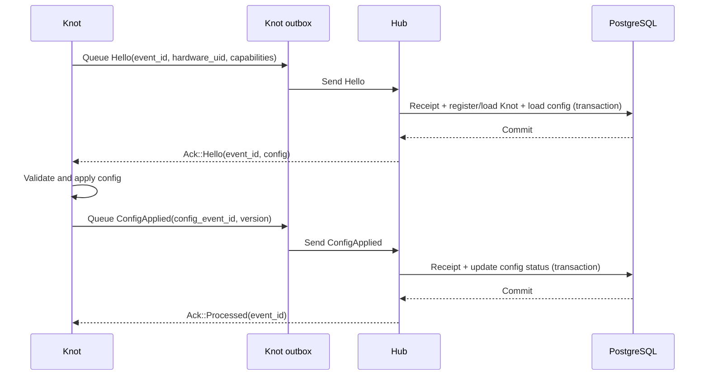

# Event Messaging

ArkSync defines versioned communication contracts between its actors. The currently implemented contract connects a Hub and a Knot, regardless of whether the Knot runs in the Hub process or on remote embedded hardware. These contracts are independent from Tokio, Embassy, MQTT, LoRa, Zenoh, and PostgreSQL.

The current delivery model is **at least once**. PostgreSQL remains the durable source of truth for station state. ArkSync stores message processing receipts for idempotence, but it does not use event sourcing.

## Responsibilities

Messaging is split across four boundaries:

- `arksync-bus` owns generic event envelopes, identifiers, Postcard helpers, and synchronous in-process routing.
- `arksync-protocol` owns the versioned, transport-independent wire contracts exchanged between ArkSync actors. The current Hub/Knot contract is scoped under `arksync_protocol::knot` so future actor-specific contracts can evolve without flattening every message into one global enum.
- `arksync-knot` owns the portable Knot protocol state machine, its bounded outbox, and runtime-specific link adapters.
- `arksync-hub` owns message processing, transaction boundaries, durable receipts, and local or remote link orchestration.

Sensor and actuator crates keep their internal application messages. Explicit mappers at the Knot and Hub boundaries prevent an internal refactor from silently changing the wire representation.

## Envelope And Frame

Every actor-specific contract uses the common `ArkSyncEnvelope`. The current `KnotEnvelope` specializes it with a `KnotMessage` payload and contains:

- an `EventId` used for correlation and idempotence;
- an `ArkSyncActor` source identifying the Hub or the Knot;
- the time at which the event occurred;
- a `KnotMessage` payload.

The wire frame starts with the ArkSync frame magic and a protocol version, followed by a Postcard-encoded envelope. Datagram transports can carry this frame directly. Stream transports add their own length delimiter outside the ArkSync frame.

Protocol enum variants are append-only within a version because Postcard encodes their discriminants. An incompatible representation requires a new protocol version and updated golden-frame tests.

## Handshake And Configuration

A new Knot announces its stable hardware UID in `Hello`. The Hub registers unknown hardware under its own identity by default and returns the current configuration in `Ack::Hello`. The configuration contains the logical Knot ID, sensor bindings, actuator configuration, and a monotonically increasing version.

The Hub can later send `Configure` without restarting the handshake. The Knot answers with `ConfigApplied` or `ConfigRejected`; both responses correlate the configuration message through its `EventId`.

Before sending configuration through `Ack::Hello` or `Configure`, the Hub records the issued `EventId`, Knot identity, version, and content in `knot_config_deliveries`. A confirmation must match that delivery and cannot contradict its previously accepted outcome. Late confirmations cannot decrease the applied version or replace the status of a newer desired version. Rejection preserves the last applied version, and startup preserves configuration state. The Knot rejects zero or older versions, identity changes, and different content with the same version.

## Hub Ownership

A Hub owns many Knots; each Knot belongs to exactly one Hub. The runtime supplies a `HubId` to each session and handler. An incoming message cannot select the Hub used for database access or responses. Configuration, heartbeat, sensor processing, configuration results, and registry loading all check this ownership.

Persistence uses `hubs`, `knots`, `knots.hub_id`, and `knot_id` on sensors, actuators, and configuration deliveries. The rename migration preserves existing rows and relationships and has an inverse rollback; older migrations retain their original names.

Hardware UIDs remain globally unique, including soft-deleted Knots. A new Hello for existing hardware retrieves the same Knot only for its active owner; another Hub receives `ConfigurationConflict`, without configuration disclosure or reassignment. Concurrent registration follows the same rule. Explicit transfer and reactivation workflows are outside this milestone.

Receipts are keyed by `(hub_id, source_hardware_uid, event_id)`, with a foreign key to the owner and hardware identity. Ownership is checked before deduplication, so a foreign message cannot reserve a receipt or be acknowledged as a previously processed message. Duplicate IDs from different Knots do not suppress each other's effects. The ownership migration backfills existing receipts; ambiguous hardware identities or orphan receipts must be resolved before migration rather than discarded. Rolling back to the old global EventId key fails if new scoped IDs collide.

## Local Sessions And Presence

`TokioKnotSession` and `HubSession` run this exchange over the local bounded link without starting any sensor or actuator driver. Each `HubSession` manages communication with one Knot; several sessions can share the same Hub identity. Callers attach `EventRouter` subscribers before starting either session, publish through a session handle, and observe the latest connection state through `status()`. The production runtimes use these same sessions.

After the Hello acknowledgement, the Knot sends `Heartbeat` probes, answered by a correlated `Ack::Heartbeat`. The default interval is five seconds, with a fifteen-second expiry, configurable through `KeepAliveConfig`. Each session tracks elapsed monotonic time; message timestamps remain wall-clock acquisition times. Heartbeats do not insert durable processing receipts or create sensors or measurements.

Connection state is volatile and distinct from the persisted Knot identity:

- `Connecting`: waiting for the handshake;
- `Connected`: the Hub has accepted the Knot, or the Knot has received a correlated acknowledgement;
- `Unavailable`: no qualifying traffic within the expiry period;
- `Closed`: the local endpoint closed or the session was explicitly stopped.

The Knot binds to the Hub identified by its Hello acknowledgement. The Hub binds its endpoint to the announcing hardware UID. Expiry preserves the current configuration; subsequent valid traffic on the same open session restores presence. A closed endpoint requires a new session. Recreating both local endpoints and sending a new Hello retrieves the same persisted Knot ID and latest configuration. Automatic supervision and network reconnection are not implemented yet.

Sending does not await a full transport while holding up ACK reception. The Knot advances retry time only after a successful send and retains pending reliable messages when the link is full. Heartbeat probes are bounded to one pending request and are replaced after expiry. The Hub bounds its response queue and pauses incoming processing when that queue fills; cancellation and presence expiry remain scheduled, including while a transactional handler awaits PostgreSQL. Handler execution has a five-second deadline. A timeout produces no ACK, allowing the sender to retry.

Session handles provide local queue acceptance, not end-to-end delivery confirmation. The Knot handle's nonblocking publish returns an unsent message on saturation. The current hardware adapter logs and discards a sensor message that cannot enter this queue; live-data prioritization and coalescing belong to the next sensor milestone. The Hub handle accepts `Configure` commands for its established peer, waits for queue capacity, and registers each delivery before enqueueing it. The legacy hardware services remain running if the communication session closes, with their last applied configuration; explicit runtime shutdown stops their parent tasks. The sensor service's internal task shutdown is a separate lifecycle improvement.

## Sensor Messages

Sensor discovery, provisioning conflicts, provisioning, and measurements use `KnotSensorMessage`. Measurements are batched at the protocol level even though the current UART runtime emits one measurement per batch.

The Hub records a processing receipt and all business effects in one database transaction. It sends `Ack::Processed` only after the transaction commits. Receiving the same `EventId` again from that Knot at its owning Hub produces another ACK without duplicating sensor registration or measurements.

An invalid sensor identity produces a terminal `InvalidPayload` NACK. The whole batch rolls back, including its receipt and sensor registrations; the registry cache changes only after commit. Database failures remain retryable and produce no ACK.

## Retry And Failure Semantics

Messages that require confirmation remain in the Knot's bounded in-memory outbox. The default policy is:

- 256 pending messages;
- one second before the first retry;
- exponential backoff capped at 30 seconds;
- no retry limit.

A retry preserves the original envelope and `EventId`. A corrected or logically new message receives a new `EventId`. Transport failures and Hub infrastructure failures produce no ACK, so the normal retry schedule applies.

The Hub also retains up to 100 pending `Configure` commands with the same retry delays, until a correlated `ConfigApplied` or `ConfigRejected` is committed. ACKs have transport priority so the Knot can drain its outbox. If that outbox is full, configuration remains unchanged until a later retry can enqueue its confirmation. Repeated commands reuse an already-pending identical confirmation.

A retryable NACK reschedules the same message immediately. A terminal NACK removes it from the outbox. Outbox exhaustion is explicit and observable rather than silently dropping a message.

The V1 outbox is volatile and does not survive an embedded-device reboot. Closing a Tokio session also discards its pending outbox; recreating an endpoint currently restores identity and configuration, not pending delivery. Flash-backed persistence and outbox handoff across sessions are future extensions.

## Router, Link, And Transport

These concepts have separate roles:

- `EventRouter` performs synchronous fan-out inside one process. It filters borrowed envelopes, invokes every matching handler, and reports successful and rejected deliveries.
- `MessageLink` is an asynchronous point-to-point port used by runtime adapters. Its send and receive operations expose link failure without defining a runtime or transport.
- A transport adapter moves complete protocol frames. MQTT, LoRa, Zenoh, or another transport must not redefine the messages.

The current Raspberry Pi runtime uses a pair of bounded Tokio endpoints for its in-process Hub/Knot link. Tests also exercise the same contract over TCP with Postcard framing and reconnection. A future ESP32 runtime will drive the portable state machine with its embedded executor and transport adapter.

Actuator execution still has a clearly named legacy local channel while its messages are migrated to the versioned protocol. This compatibility path is temporary and does not define the future wire contract.
